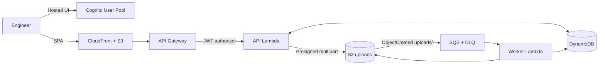

# PartVault — Mini Cloud PDM for Hardware Teams

PartVault is a production-grade, serverless Product Data Management (PDM) system for hardware teams. Parts, revisions, BOMs, and CAD files are versioned, locked, audited, and processed asynchronously — all on AWS with pay-per-use pricing.


## Features

- Parts & revision lifecycle (Draft → In Review → Released, immutable releases)
- Direct-to-S3 multipart uploads (up to 2 GB) with SHA-256 content addressing
- Async file pipeline (S3 → SQS → Lambda) with STL metadata extraction
- Check-out/check-in locks with expiry and admin override
- BOM tree, where-used, CSV export, diff, and cycle prevention
- Role-based access (admin / engineer / viewer) via Cognito groups
- Audit log, CloudWatch alarms, and CI/CD via GitHub OIDC

## Architecture



## Quickstart

### Prerequisites

- Node.js 22+, pnpm 9+
- AWS account (region `ap-south-1` default, configurable via `AWS_REGION`)
- Named AWS profile with admin-equivalent permissions

### Install

```bash
pnpm install
pnpm build  # builds shared, api, worker, web
```

### Bootstrap CDK (one-time)

```bash
export AWS_PROFILE=partvault
export AWS_REGION=ap-south-1
export STAGE=dev
export ALARM_EMAIL=you@example.com
pnpm infra:bootstrap
```

### Deploy

```bash
pnpm infra:deploy
```

Outputs include `ApiUrl`, `WebUrl`, `UserPoolId`, `WebClientId`, and `CognitoDomain`. Copy them into `apps/web/.env`:

```bash
cp apps/web/.env.example apps/web/.env
# edit values from cdk outputs
```

### Seed demo data

```bash
export TABLE_NAME=$(aws cloudformation describe-stacks --stack-name PartVault-dev --query "Stacks[0].Outputs[?OutputKey=='TableName'].OutputValue" --output text)
export BUCKET_NAME=$(aws cloudformation describe-stacks --stack-name PartVault-dev --query "Stacks[0].Outputs[?OutputKey=='UploadsBucketName'].OutputValue" --output text)
export USER_POOL_ID=$(aws cloudformation describe-stacks --stack-name PartVault-dev --query "Stacks[0].Outputs[?OutputKey=='UserPoolId'].OutputValue" --output text)
pnpm seed
```

Demo users: `admin@demo.local` / `engineer@demo.local` / `viewer@demo.local` (passwords in `scripts/seed.ts` — change for production).

### Local dev

```bash
pnpm --filter partvault-web dev  # http://localhost:5173
```

## Documentation

- [Data model](docs/data-model.md) — DynamoDB single-table design and access patterns
- [ADRs](docs/adr/) — trade-off records
- [Runbook](docs/runbook.md) — DLQ investigation, reprocessing, rollback
- [Security](docs/security.md) — presigned URL scope, authZ, file validation

## Cost estimate

Pay-per-use only (Lambda, DynamoDB on-demand, S3, SQS, CloudFront, Cognito, CloudWatch). At demo scale: **< $10/month**. A Budgets alert fires at 80% of $10.

## Teardown

```bash
pnpm infra:destroy
```

## Screenshots

  
  


## Tests

```bash
pnpm test           # Vitest unit tests
pnpm typecheck      # strict TS
pnpm lint           # ESLint + Prettier
pnpm --filter ./infra synth  # CDK synth
```
